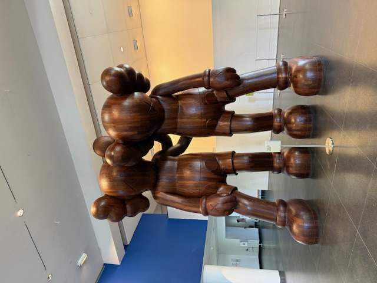
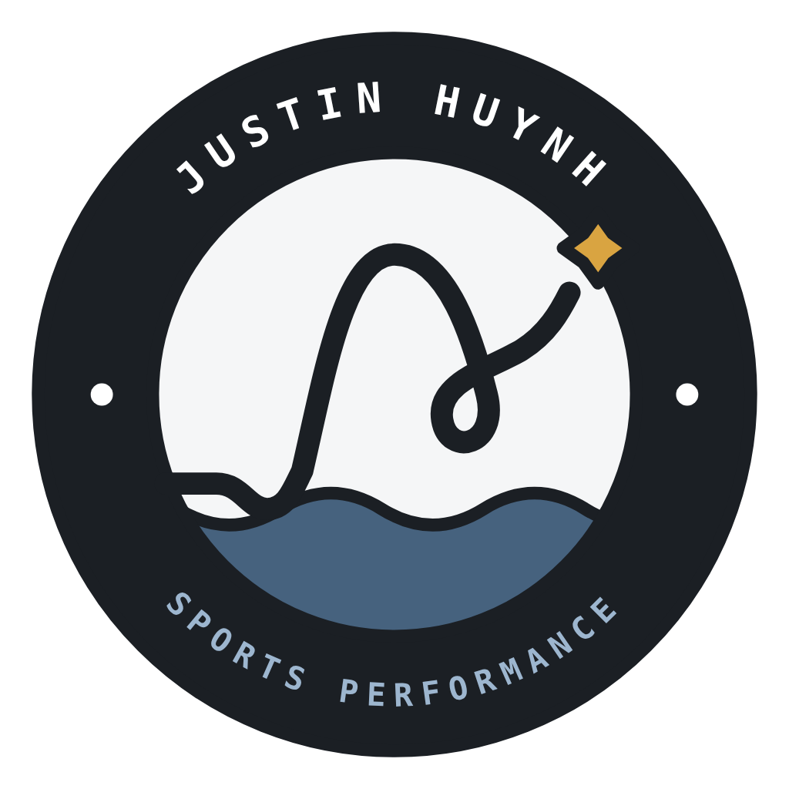
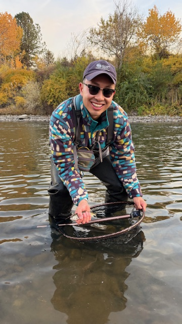

# Introduction

Welcome to the first post! If you're reading this when it's first published, thank you! If I end up writing down the road and somehow, in some way, become "well-renowned" (something I really don't seek or want), and you end up going down the rabbit hole, thank you!

If you want to learn more about me, just [click here](https://justintrihuynh.github.io/#about), or if you want to dive into my resume, [here it is](https://justintrihuynh.github.io/#experience).

# The Lore – The Crisis of Writing

After graduating from the University of Puget Sound, I became a personal trainer for a small business, COR Physical Therapy and Personal Training. Dr. John Mullen (Mr. Triple OG), the owner at the time, encouraged me to write a few articles. I managed to get a few articles published on STACK and Swimming World Magazine.

Writing has always been something I have **despised**! In high school and college, whenever people looked at my work, it was dreadful. But writing articles was calming, engaging, and freeing. Maybe expressing ideas about training (something I'm clearly passionate about) is much easier than writing a thesis on Beowulf or wading through bland statistics in a lab I'm not particularly enthusiastic about.

That being said, I want to write about once a month to get some thoughts out. Writing allows me to put my thoughts on "paper" so ideas become concrete. To those reading this, throw your opinion into the mix: Is my thought process on the right track?

If you find it entertaining and relatable, please comment or email me. I want to attract like-minded individuals who want to collaborate because I don't claim to have all the answers.

# The Logo – Nike, Jordan, Undefeated, KAWS, Patagonia... The List Goes On

This is more anecdotal, but if you love sports and work in basketball, there's a pretty good chance you **LOVE** sneakers. There's also a good chance you appreciate some form of fashion brand, streetwear, or pop art.

No, I'm not talking about going to the Louvre and seeing the Mona Lisa (still a great experience). I mean going to the Brooklyn Museum, only to be really thrilled about seeing a Kith T-shirt in the bookstore and a Godzilla-like statue of the KAWS logo.

I'm generally labeled as an analytical person. I love learning about systems, organization, and how to apply them. I'm a highly kinesthetic and visual learner.

As a teenager, I picked up the guitar. I loved the drills and monotony, but when it came to creating a solo, I was awful. Unfortunately, not being able to shred notes on a fretboard deterred me a bit. Honestly, I felt like it connected to my writing. My creative instincts just weren't there.

However, logos and brands that were catchy always stood out to me. Look at the Nike Swoosh, the Jordan Jumpman silhouette, or the KAWS X. Something about those designs always caught my attention. They were timeless, bold yet simple, with a boutique feel and natural versatility.

So, when you see my logo, understand that it's a work in progress, but it represents something more. When I plugged my ideas into Claude (yes, I'm using AI services to help me), I wanted something that resembled what I believed in and what defined me.

**NO, IT IS NOT AN EKG!!**

Okay, I get it. The logo currently looks like an EKG, but the idea is that it represents the different phases of a countermovement jump when viewed through a force plate.

Force plates have always fascinated me as a coach. I've always wanted to dunk a basketball (still a work in progress), which has made me want to continue pursuing my physical potential.

Seeing the eccentric braking, transition/amortization, and propulsive phases of a jump has always signaled progress to me. Training rewards consistency and hard work. If you're not serious, you won't get to where you want to go. If you work hard, remain consistent, and stay process-oriented (think delayed gratification), you give yourself the opportunity to reach your potential.

If you hone in on the line within the logo, you'll notice that it breaks through the circle. To me, that symbolizes breaking through barriers and pursuing one's potential.

The line itself also represents something personal: getting out of my comfort zone.

I'm a hermit. I love staying at home, but I've realized I need new hobbies. Fun fact for young coaches: training all the time, learning about training, giving back to the student-athletes you serve, and being a foodie is great and all, but it can make you pretty one-dimensional.

Recently, I took up fly fishing. One of my coworkers, Keita, took me out to the South Fork of the Boise River, and I was hooked! Two of my uncle's friends, Marc (Obi-Wan) and Doug (Yoda), gave me some additional lessons. The cerebral aspect of choosing the right fly, reading a river, and developing the technical skills has me hooked.

I'm by no means a master fly fisherman. I'm a novice, learning, growing, and iterating on what I need to do better to catch some fish. Right now, call me a stubborn Anakin from Episode II.

The overall aesthetic was also important to me. I wanted the logo to have the kind of recognizable silhouette you see with Nike and the Jumpman: something that stands out but remains simple. The feel was meant to resemble pop art: relaxed, fun, and inviting.

> _The logo represents breaking through barriers and pursuing one's potential._

I want the logo to evolve and grow, reflecting the journey of becoming something better than where it started.

# In Closing

I don't claim to be the best performance coach out there. I'm still an applied sports scientist in training.

Honestly, life is a continuous work in progress, full of peaks and valleys. The intent is ultimately to grow and climb toward the peak you've envisioned, knowing that the end is never really in sight.

Let's go on this journey together and discover where potential lies. The path may not have an end, but the journey itself is where the fun begins.
